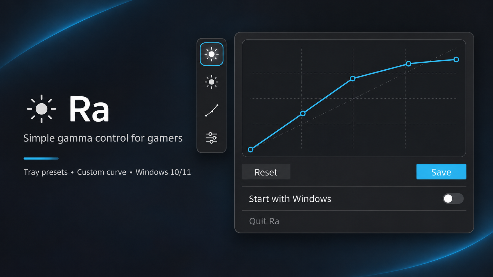

# Ra — Free Windows Gamma Control for Gamers

**Stop playing in the dark. Take control of what you see.** Whether you're exploring shadowy dungeons, navigating dark environments, or struggling to make out what's ahead, Ra gives you control over your game's gamma. Brighten dark scenes, bring out shadow details, and fine-tune your display with ready-to-use presets or custom gamma curves with instant preview. Switch settings in seconds from your Windows system tray. Free, lightweight, and distraction-free. No accounts, no subscriptions, no hassle — just a clearer view of your game.

**[Download Ra for Windows (.exe) — Free](https://github.com/sobrilo8/ra-releases/releases/download/v0.4.1-net10-preview.1/Ra-Setup-v0.4.1-net10-preview.1-win-x64.exe)**

[Portable ZIP](https://github.com/sobrilo8/ra-releases/releases/download/v0.4.1-net10-preview.1/Ra-v0.4.1-net10-preview.1-portable-win-x64.zip) · [Release notes and SHA-256 checksums](https://github.com/sobrilo8/ra-releases/releases/tag/v0.4.1-net10-preview.1)

*Windows 10/11 x64 · SDR display gamma adjustment · Unsigned prerelease. Some games, HDR modes and drivers may override Windows gamma changes.*

**Free Windows utility · Publisher display name: Vaster · Early preview**

Ra is a lightweight Windows system-tray application that adjusts Windows SDR display gamma curves using the Windows GDI gamma-ramp API. It offers Gamma 1.3, Gamma 1.5 and a user-editable Custom curve, with Neutral to stop Ra's adjustment.

**This is a binary-distribution repository.** The development source code and its Git history are not hosted here. The application is distributed under the included MIT license; that license does not require the source repository to be made public.

## Requirements and limitations

- Windows 10 or 11, x64, on a graphics path supporting GDI gamma ramps.
- The downloadable self-contained build does not require a separate .NET installation.
- Display-driver, HDR, ICC/color-management, multi-monitor, fullscreen and anti-cheat compatibility are not broadly tested.
- Ra is not a monitor calibration tool and does not measure actual physical brightness or color accuracy.
- Gamma changes can be overwritten by Windows, drivers or other apps; crashes or forced termination can prevent restoration.

## How to use

- **Gamma 1.3 / 1.5:** choose a preset from the tray menu.
- **Custom:** open Settings, drag points to preview, click Save to persist the curve, or press Escape to cancel unsaved edits.
- **Neutral:** request restoration of the previous ramp when Ra still owns its last verified write.
- **Left-click the tray icon:** toggle Neutral and the last non-neutral profile.
- **Right-click the tray icon:** open presets and Settings.
- **Start with Windows:** optional, off by default during installation.

Custom point coordinates are persisted to four decimal places. A curve reloaded after restarting may therefore differ numerically from the pre-save, full-precision curve. Its visual impact has not been measured.

## Download, integrity, installation

Download the [current Ra 0.4.1 preview](https://github.com/sobrilo8/ra-releases/releases/tag/v0.4.1-net10-preview.1) or use the direct installer link above. The release also includes a portable ZIP and matching `.sha256` files. Compare the download SHA-256 with the published checksum before running it.

Quit any running Ra normally using **Settings → Quit Ra** before installing, updating or uninstalling it. The installer normally installs per user into `%LOCALAPPDATA%\Programs\Ra`; it offers an optional desktop shortcut and post-install launch.

**Unsigned preview:** this release's installer and application are not digitally signed. Windows may display warnings or block execution. Respect Windows security decisions; do not disable security protections.

Saved preferences are local in `%LOCALAPPDATA%\Ra\state.txt` and are normally retained after uninstall. See [PRIVACY.md](PRIVACY.md).

## Support and security

See [SECURITY.md](SECURITY.md) for the private vulnerability-reporting policy. Private vulnerability reporting is enabled for this public repository.

## License

Ra is distributed under the [MIT license](LICENSE) with the existing Ra contributors and Vaster copyright notices. The installer contains applicable license and third-party notice files for bundled Microsoft .NET components.
